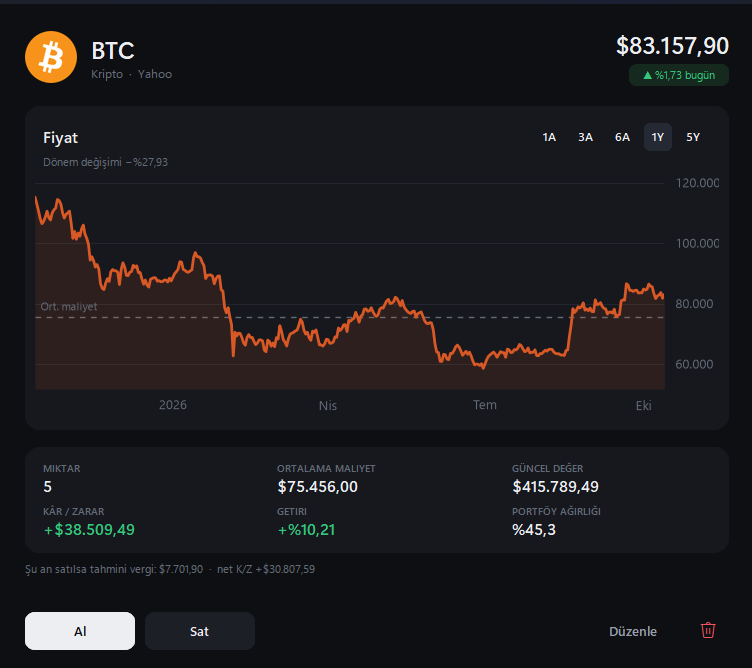

# 📈 Borsa Portföy Sistemi

### Hisse, kripto ve fon yatırımlarını tek ekrandan takip et

Python ile geliştirdiğim modern arayüzlü masaüstü portföy yönetim aracı

 

---

## 📖 Hakkında

Farklı platformlarda dağınık duran yatırımları tek bir yerde toplamak için geliştirdiğim bir masaüstü uygulaması. Hisse senedi, kripto para ve yatırım fonu pozisyonlarını ekliyorsun; uygulama güncel fiyatları kendisi çekiyor, maliyetini, kâr/zararını ve tahmini vergini hesaplıyor, portföyünün zaman içindeki değişimini grafiklerle gösteriyor.

Arayüzü CustomTkinter ile sıfırdan, kendi bileşen kütüphanemi (kartlar, KPI kutuları, rozetler, bildirimler) oluşturarak tasarladım. Amacım, bir masaüstü Python uygulamasının da modern bir finans uygulaması kadar şık ve anlaşılır görünebileceğini göstermekti.

## ✨ Özellikler

<table>
<tr>
<td width="50%" valign="top">

### 🏠 Genel Bakış
Portföyün bugünkü değeri, toplam maliyet, net kâr/zarar ve tahmini vergi tek bakışta

### 💼 Varlıklar
Tüm pozisyonlar tek tabloda; bir satıra tıklayınca varlığın ayrıntısı, istatistikleri ve fiyat grafiği açılır

</td>
<td width="50%" valign="top">

### 🔁 İşlemler
Alım ve satım geçmişi, gerçekleşen kâr/zarar ve satışlardan doğan vergi

### 📊 Analiz
Varlık dağılımı, kâr/zarar karşılaştırması ve portföyün değer geçmişi grafikleri

</td>
</tr>
</table>

**Ayrıca:**
- 🔄 Güncel fiyatların otomatik çekilmesi (hisse ve kripto için Yahoo Finance, TEFAS fonları için ayrı kaynak)
- 💱 USD/TRY kuruyla farklı para birimindeki varlıkların TL karşılığı
- 🧾 "Şu an satılsa" tahmini vergi ve vergi sonrası net kâr/zarar
- 📈 Grafiklerde fareyle üzerine gelince değer gösteren etkileşimli ipuçları
- 📤 Portföyü Excel dosyasına aktarma
- 💾 Tüm veriler yerelde, SQLite veritabanında

## 🖼️ Ekran görüntüleri

<table>
<tr>
<td width="62%"></td>
<td width="38%"></td>
</tr>
</table>

## 🛠️ Teknik yapı

| Alan | Kullanılan |
|---|---|
| Dil | Python |
| Arayüz | CustomTkinter, Pillow |
| Grafikler | Matplotlib |
| Piyasa verisi | yfinance, requests |
| Veri | SQLite |
| Dışa aktarma | openpyxl (Excel) |

---

🔒 Bu depo yalnızca projenin tanıtımı içindir; kaynak kodu paylaşılmamaktadır.

**[tetik.dev](https://tetik.dev/projects.html)** · Muhammed Ali Tetik

