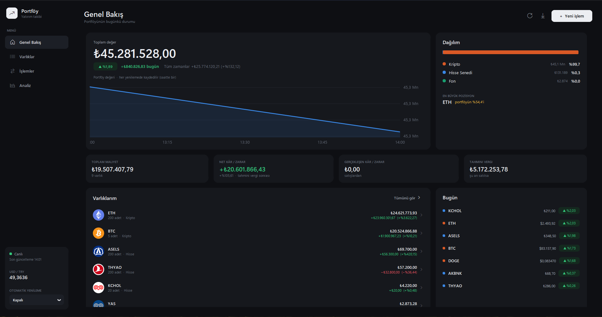

# Borsa Portföy Sistemi

Python ile geliştirdiğim hisse senedi portföy yönetim aracı.

## Hakkında

Python ile geliştirdiğim, hisse senedi yatırımlarınızı ve portföy durumunuzu tek bir ekrandan düzenli bir şekilde takip edebileceğiniz bir yönetim aracı.

## Teknolojiler

Python · Veri Analizi · Portföy Takibi

---

> Bu depo yalnızca projenin tanıtımı içindir; kaynak kodu paylaşılmamaktadır.
